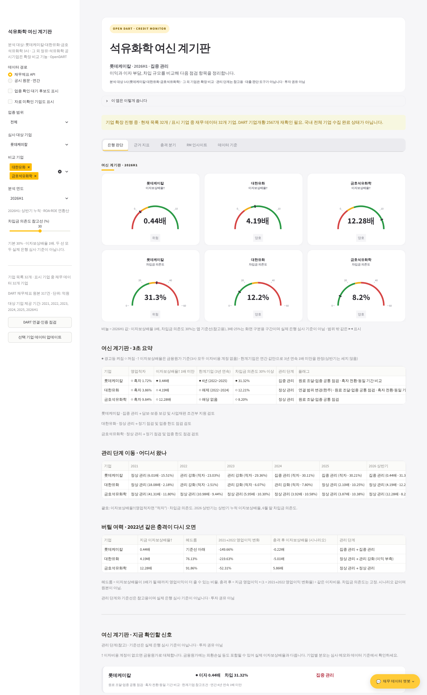
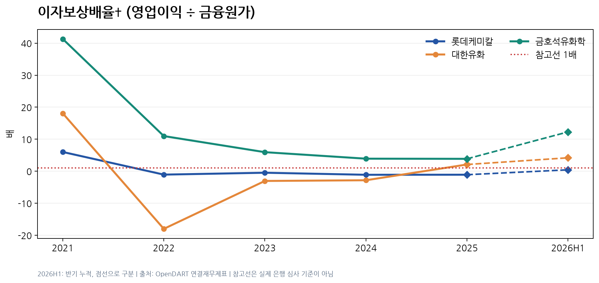
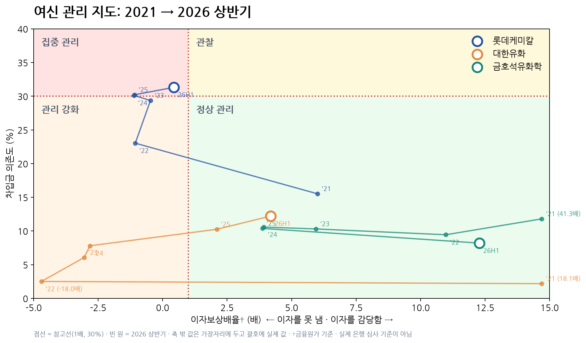
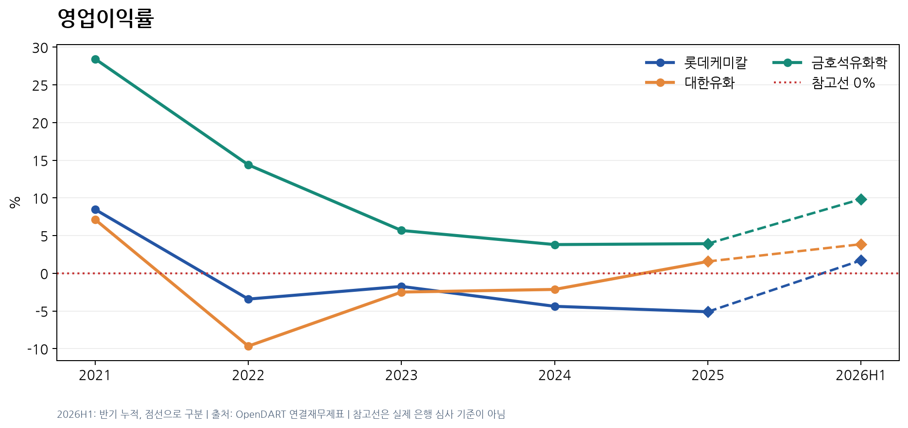
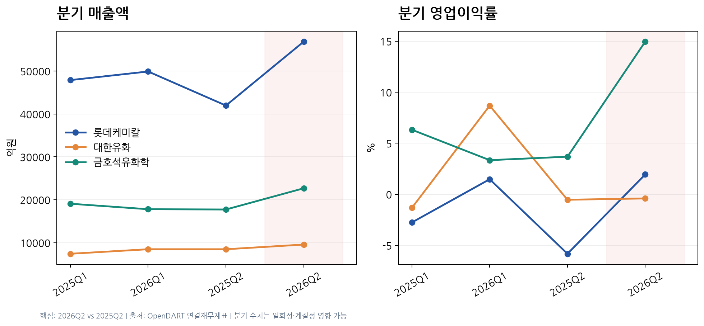

# 석유화학 여신 계기판 — 불황 4년, 은행은 누구의 빚을 걱정하나

> DART 공시로 석유화학 3사(롯데케미칼·대한유화·금호석유화학)의 2021~2026 상반기 재무제표를 모아 지표를 계산하고, 은행 심사역 관점의 **Streamlit 여신 계기판**으로 만들었습니다.
> **부채비율이 3사 중 가장 낮았던 대한유화도 이자보상배율은 3년 연속 1배 미만**이었습니다. 위험은 부채비율보다 이자 감당 능력에서 먼저 보였습니다.

| 항목 | 내용 |
|---|---|
| 형태 | KB Bridge 부트캠프 Module 04 미니프로젝트 04 · 6인 팀 (2조: 원승연 · 김동민 · 정지수 · 조진영 · 김민지 · 조윤호) |
| 사용 기술 | Python (requests, Pandas, Plotly, Matplotlib) · OpenDART API · Streamlit · SQL (SQLite) · Google Colab |
| 데이터 | DART 전체 재무제표(연결) 원본 JSON 317개 · 분석 3사 연간 2021~2025 + 2026 상반기 + 분기 |
| 핵심 결과 | 영업적자 연도 롯데 4년 · 대한 3년 · 금호 0년 · 2026H1 흑자에도 롯데는 "집중 관리" 유지 |

**내 역할** : 여신 계기판 앱 통합·보완과 데이터 정합성 점검 — 앱 화면(은행 판단 탭·관리 지도·스트레스 시나리오·차트)의 가독성 문제를 고치고, 앱과 보고서 숫자가 다르던 원인을 찾아 지표를 재생성, DART 수집 오류를 고쳐 비교 기업 데이터를 64개사로 확보, 보고서 v2 재작성과 리눅스·코랩 실행 오류 수정 (트러블슈팅 기록 15건 담당)



---

## 01. 프로젝트 배경

석유화학 업종은 2022년부터 4년째 불황입니다. 2024년 롯데케미칼은 회사채 재무특약을 지키지 못해 은행 보증을 받았고, 2026년에는 대산 석유화학 사업재편이 진행됐습니다.
은행 입장에서 질문은 "어느 회사가 좋은가"가 아니라 "**이미 빌려준 돈을 어떻게 지킬 것인가**"입니다. 그래서 기업 성적표가 아니라 은행의 판단을 돕는 계기판을 만들었습니다.

## 02. 업무 문제

| 질문 | 보는 지표 |
|---|---|
| Q1. 돈을 벌고 있나 | 매출 성장률, 영업이익률, ROA, ROE |
| Q2. 이자를 감당하나 | 이자보상배율 (영업이익 ÷ 금융원가) |
| Q3. 빚이 늘고 있나 | 부채비율, 차입금 의존도 |
| Q4. 빌려준 돈은 어떻게 지키나 | 관리 단계(정상·주의·집중 관리), 2022년 충격 재현 시나리오 |

**대상 선정** — 석유화학 12곳을 관문 4개(상장·공시, 석유화학 주력, 나프타 원료, 극단값 없음)로 걸러 규모와 제품 구성이 다른 3사를 골랐습니다.

## 03. 데이터 설명

| 데이터 | 출처 | 내용 |
|---|---|---|
| 전체 재무제표 | OpenDART `fnlttSinglAcntAll` | 사업보고서(11011)·반기(11012)·1분기(11013), 연결(CFS) 기준 |
| 기업 고유번호 | OpenDART `corpCode` | 분석 3사 + 비교 기업 목록 |
| 감사보고서 원문 | DART 공시 원문 | 차입금 구성·담보·약정 등 주석 확인 |
| 이벤트 | 공시·신용평가 자료 | 재무특약·신용보강·사업재편·연결 편입 (출처 확인된 것만) |

- 원본 JSON 317개와 수집 로그는 `data/raw_DART원본.zip`에 압축해 두었습니다(GitHub 업로드 파일 수 제한 때문).
- 정제·지표·비교 결과는 `data/processed/`에 있고, 앱은 이 CSV만으로 **API 키 없이 실행**됩니다.

## 04. 데이터 전처리

| 처리 | 내용 |
|---|---|
| 계정 매핑 | 원본 계정명을 공통 항목(매출·영업이익·차입금 등)으로 매핑하고 출처를 `account_mapping.csv`에 기록 |
| 이자비용 대체 | 3사 모두 이자비용 단독 계정이 없어 **금융원가**로 대체하고 `icr_basis` 열에 표시 |
| 결측 처리 | 결측 연도를 0으로 채우지 않음. 차입금 매핑이 불완전하면 지표를 비우고 판정 보류 |
| 반기 연환산 | 상반기 ROA·ROE는 순이익 × 2로 연환산, 반기 누적 금액은 연간과 직접 비교하지 않음 |
| 전기 기준 통일 | 성장률의 전기 값은 당기 보고서에 재작성된 금액 기준으로 통일 |
| 재현 검증 | 새 폴더에서 `rebuild.py`를 다시 실행해 결과가 제출본과 한 글자도 다르지 않음을 확인, 테스트 22개 통과 |

## 05. SQL 분석

지표 테이블을 SQLite에 적재해 핵심 결론을 SQL로 다시 확인했습니다. → [`sql/credit_signal_check.sql`](sql/credit_signal_check.sql)

```sql
-- 2021~2025 영업적자 연도 수와 이자보상배율 1배 미만 연도 수
SELECT corp_name,
       SUM(op_income < 0) AS 영업적자_연도,
       SUM(icr < 1)       AS 이자보상배율_1배미만_연도,
       ROUND(MIN(debt_ratio), 2) AS 최저_부채비율
FROM metrics
WHERE stock_code IN ('011170', '006650', '011780') AND period_type = 'FY'
GROUP BY corp_name;
```

| 기업 | 영업적자 연도 | 이자보상배율 1배 미만 연도 | 부채비율 범위 |
|---|---:|---:|---|
| 롯데케미칼 | 4 | 4 | 48.0 – 76.5% |
| 대한유화 | 3 | 3 | **17.9 – 29.7%** |
| 금호석유화학 | 0 | 0 | 35.7 – 59.7% |

```sql
-- 부채비율은 낮은데(50% 미만) 이자보상배율이 1배 미만인 연도
SELECT corp_name, period, ROUND(debt_ratio, 2) AS 부채비율, ROUND(icr, 2) AS 이자보상배율
FROM metrics
WHERE stock_code IN ('011170', '006650', '011780') AND debt_ratio < 50 AND icr < 1;
```

→ 대한유화 2022·2023·2024년. 부채비율(17.9%·20.4%·22.8%)만 보면 가장 안전해 보이지만, 영업이익으로 이자를 내지 못한 해였습니다.

## 06. Python 분석

**파이프라인**

| 단계 | 스크립트 | 결과 |
|---|---|---|
| ① 기업 고유번호 조회 | `source/00_discover_companies.py` | 기업 목록 |
| ② 재무제표 수집 | `source/01_collect.py`, `collect_expanded.py` | 원본 JSON, 수집 로그 |
| ③ 정제·계정 매핑 | `source/02_clean.py` | `financials_clean.csv`, `account_mapping.csv` |
| ④ 지표 계산 | `source/03_metrics.py`, `03b_quarterly.py` | `metrics.csv`, `quarterly_metrics.csv` |
| ⑤ 비교·차트·보고서 | `source/04_compare.py`, `render_charts.py`, `render_report.py` | 비교표, 차트 7개, 보고서 PDF |
| 검증 | `source/validate_data.py`, `test_*.py` | 데이터 정합성, 관리 단계 로직, 수집 로직 테스트 |

**관리 단계 (참고용, 실제 은행 심사 기준 아님)** — 이자보상배율 1배와 차입금 의존도 30%를 기준선으로 두 축 지도 위에 기업을 놓고 정상·주의·집중 관리로 나눕니다. 2022년 수준의 충격이 다시 오면 어느 칸으로 움직이는지 시나리오로 보여줍니다.

## 07. 시각화

| 이자보상배율 추이 (1배 기준선) | 여신 관리 지도 |
|---|---|
|  |  |

| 영업이익률 추이 | 2025 vs 2026 분기 실적 |
|---|---|
|  |  |

**Streamlit 앱 탭** — 은행 판단(계기판·경고등·관리 지도·충격 시나리오·주석 확인·심사 메모) / 근거 지표 / 충격 분기 / RM 인사이트 / 데이터 기준. 탭별 화면은 [`output/app_screens/`](output/app_screens/)에 있습니다.

## 08. 주요 인사이트

| 기간 | 영업이익률 (롯데 / 대한 / 금호) | 이자보상배율 (배) | 부채비율 |
|---|---|---|---|
| 2021 | 8.47 / 7.13 / 28.44 | 6.01 / 18.08 / 41.31 | 48.01 / 22.16 / 59.67 |
| 2022 | −3.42 / −9.66 / 14.39 | −1.06 / −18.00 / 10.98 | 55.14 / 17.93 / 36.54 |
| 2024 | −4.38 / −2.14 / 3.81 | −1.11 / −2.82 / 3.92 | 72.87 / 22.80 / 38.03 |
| 2026H1 | 1.72 / 3.86 / 9.84 | 0.44 / 4.19 / 12.28 | 76.76 / 35.58 / 34.40 |

1. **불황에서 갈린 건 규모가 아니라 적자 여부였다.** 가장 큰 롯데케미칼이 4년 연속 영업적자였고, 스페셜티 비중이 큰 금호석유화학은 한 해도 적자가 없었습니다.
2. **부채비율보다 이자보상배율이 위험을 먼저 보였다.** 부채비율이 가장 낮은 대한유화도 3년 연속 영업이익으로 이자를 내지 못했습니다.
3. **흑자 전환만으로 관리 조건을 풀면 안 된다.** 2026 상반기 3사 모두 흑자였지만, 롯데케미칼은 이자보상배율 0.44배·차입금 의존도 31.3%로 집중 관리 칸에 남았습니다.

## 09. 생산·제조 업무 활용 방안

| 이 프로젝트 | 생산·제조 현장 적용 |
|---|---|
| 부채비율은 낮은데 이자보상배율 1배 미만 | 겉보기 지표(가동률)는 좋은데 실제 손실 지표(불량·재작업 비용)가 나쁜 설비 → **한 지표만 보면 놓치는 위험** |
| 기준선 2개(1배·30%)로 정상·주의·집중 관리 구분 | 설비 상태를 진동·온도 등 2개 축의 관리 기준으로 나눠 보전 우선순위 결정 |
| 흑자 전환해도 관리 단계 유지 | 고장 수리 후 한 번 정상이 나왔다고 바로 감시를 해제하지 않음 |
| 2022년 충격 재현 시나리오 | 원자재 가격 급등·주요 설비 정지 같은 충격이 다시 오면 어디가 버티지 못하는지 미리 점검 |
| 앱과 보고서 숫자 불일치 → 원인 추적 후 재생성 | 시스템 집계값과 보고서 값이 다를 때, 계산 기준(전기 금액 기준)부터 추적해 한 기준으로 통일 |
| 차트에 64개사를 다 그리지 않고 5곳만 강조 | 현장 대시보드는 모든 설비를 같은 무게로 보여주지 않고, 조치가 필요한 대상만 눈에 띄게 |
| 윈도우·리눅스·코랩 실행 오류 수정 | 장비·OS가 달라도 같은 결과가 나오도록 하는 표준화 |

## 10. 한계 및 개선 방향

- **이자보상배율은 금융원가 기준**입니다. 금융원가에는 외환·파생 손실이 섞일 수 있어 실제 이자 기준보다 낮게 나올 수 있습니다.
- 관리 단계와 기준선(1배·30%)은 분석용 참고선이며 실제 은행 심사 기준이 아닙니다. 3년 연속 1배 미만은 한계기업 "참고 조건"일 뿐 공식 분류가 아닙니다.
- 대한유화는 2025년 연결 범위가 바뀌어(한주 편입) 2025년 성장률 해석에 주의가 필요합니다.
- 분석 대상은 3사이며, 비교 기업 데이터는 참고용입니다. 투자 권유 목적이 아닙니다.

---

### 실행 방법

```bash
pip install -r requirements.txt
python -m streamlit run app/app.py   # Windows는 run_app.bat 더블클릭 (API 키 불필요)
python sql/run_sql.py                # SQL 확인
```

원본부터 다시 만들려면 `data/raw_DART원본.zip`을 `data/` 폴더에 풀고 `python source/rebuild.py`를 실행합니다. 맥·윈도우·코랩 실행 안내와 지표 정의는 [`docs/제출용_상세README.md`](docs/제출용_상세README.md), 앱 기능은 [`docs/APP_FEATURES.md`](docs/APP_FEATURES.md), 작업 중 해결한 문제는 [`docs/TROUBLESHOOTING.md`](docs/TROUBLESHOOTING.md)에 있습니다.

### 폴더 구조

```
09_석유화학3사_여신계기판/
├─ README.md
├─ app/           # Streamlit 여신 계기판 (화면 모듈 포함)
├─ source/        # 수집 → 정제 → 지표 → 비교 → 차트 → 보고서, 테스트
├─ colab/         # Google Colab 실행 노트북
├─ data/          # processed(정제·지표 CSV), raw_DART원본.zip(원본 JSON 317개)
├─ sql/           # SQL 확인 쿼리 + 실행 스크립트
├─ output/        # 비교 차트 7개, 앱 탭별 화면
├─ report/        # 분석결과 요약보고서 PDF
├─ presentation/  # 발표자료 PPT
└─ docs/          # 제출용 상세 README, 앱 기능, API 명세서, 감사보고서 가이드, 트러블슈팅
```
